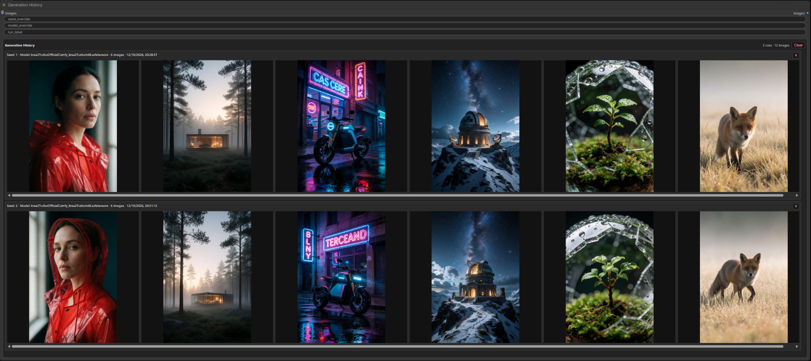

# ComfyUI Generation History

**Generation History** is a ComfyUI image pass-through node for comparing
generated images directly on the workflow canvas. Each queued execution that
reaches the node creates one row containing all images received by that node,
including normal batches and repeated sequential/list invocations.

A batch of 20 images and 20 sequential one-image invocations in the same queued
execution both produce one row with 20 non-wrapping thumbnails. The next queued
execution adds a new row below it.

It is designed for quick visual comparisons while changing checkpoints,
diffusion models, LoRAs, prompts, seeds or sampler settings without leaving the
workflow canvas.



## Features

- One Queue Prompt = one run, across normal batches and sequential/list calls.
- Oldest run first, vertical history scroll, independent horizontal row scroll.
- Full-resolution image viewer with previous/next buttons, arrow-key navigation,
  and close via `Esc`, `×` or the backdrop.
- Automatic best-effort seed, UNet/checkpoint and LoRA metadata detection.
- Responsive rows, headers and thumbnails that follow live node resizing.
- Separate JPEG thumbnails (up to 512 px) so rows load smaller images; the
  image viewer loads the original full-resolution PNG.
- Optional seed/model overrides and run label under the node's advanced inputs.
- Per-run deletion and per-node **Clear**; only Clear asks for confirmation.
- No run count, image count, LRU or age-based automatic deletion.
- Unmodified `IMAGE` pass-through output.
- Separate UUID-backed history for every node instance, including duplicates.

## Installation

Clone the repository inside `custom_nodes`:

```bash
cd ComfyUI/custom_nodes
git clone https://github.com/lorenzotosi/ComfyUI-GenerationHistory.git
```

Alternatively, download the repository ZIP and extract it so that `__init__.py`
is directly inside:

```text
ComfyUI/custom_nodes/ComfyUI-GenerationHistory/
```

No extra `requirements.txt` is needed. The implementation only uses Python,
aiohttp, NumPy and Pillow components already required by ComfyUI.

Restart ComfyUI after copying the directory, then refresh the browser.

## Compatibility

- Python 3.10 or newer, as declared in `pyproject.toml`.
- ComfyUI with `comfy_execution.utils.get_executing_context` and an execution
  context exposing `prompt_id` for grouping invocations.
- A frontend that supports JavaScript extensions and `addDOMWidget`.

The node has no third-party dependencies beyond packages already provided by
ComfyUI.

## Usage

Add **Generation History** from `image/history` and connect it like this:

```text
VAE Decode → Generation History
```

Scroll vertically between runs and horizontally within a row. Click a thumbnail
to open the image viewer. The row's `×` deletes that run immediately; **Clear**
removes all runs belonging to this node after confirmation.

Inputs:

- `images`: the `IMAGE` batch received in the current invocation. Repeated
  invocations from the same Queue Prompt are appended to the same run.
- Advanced `seed_override`: blank uses automatic detection.
- Advanced `model_override`: blank uses automatic detection.
- Advanced `run_label`: optional short title shown at the start of the row.

The `images` output returns the original input. Overrides change only displayed
metadata; they do not change generation settings.

The internal history UUID is hidden from the normal node UI. Each frontend
node instance receives a fresh UUID, including duplicated nodes and nodes
restored from a workflow. Opening the same workflow in two tabs creates
independent galleries; their Clear, Delete and cleanup operations do not affect
each other. The UUID saved in the workflow is replaced when the node is loaded.

The legacy `persist_history` widget is hidden and ignored; it does not enable
persistent storage.

### Run grouping

Generation History groups work by ComfyUI execution identity, not by time,
seed, model, prompt text or image filename. This means:

- one Queue Prompt creates one run per node that receives images;
- every normal batch and sequential/list invocation from that execution is
  appended to the same row in arrival order;
- two Queue Prompts with identical parameters still create two distinct runs;
- partial results remain available if a later step in the execution fails.

If ComfyUI does not supply an execution context at runtime, each invocation is
recorded separately and a warning is logged; sequential grouping then cannot
be guaranteed.

## Session storage

Run metadata is held in server memory. Images are stored at their original
dimensions as 8-bit PNGs under:

```text
<ComfyUI temp>/generation_history/session_<id>/<history_id>/<generation>/run_<number>/
```

Opening or reloading the workflow starts an empty gallery and removes the
current session's temporary files for that node. Restarting ComfyUI also starts
a new session; previous galleries are not restored. ComfyUI manages cleanup of
its temp directory. Each gallery generation uses distinct image URLs to avoid
displaying cached images from an earlier gallery.

Delete and Clear remove the matching temporary image directories. Run numbers
are not reused after Delete or Clear within an active gallery. There is no
automatic retention limit, so large histories consume memory and temporary
disk space. Removing the node also releases its images and run metadata.
On browser reload or tab close, the frontend attempts to release its gallery
with a keepalive request. Pages kept in the browser's back-forward cache retain
their gallery.
Pending batches are discarded if the gallery is cleared, reset or released
while those images are being encoded. Filesystem deletion errors are reported
and the run metadata is retained so cleanup can be retried. Clear and Delete
requests made during another operation are queued and performed in order.

Temporary files keep the full-resolution history out of the Python process's
RAM and VRAM; only metadata is retained in memory. PNGs use fast lossless
compression. Each image also has a JPEG thumbnail, limited to 512 px on its
longest side, to reduce transfers and decoded image memory in the browser.
Encoding happens outside the history lock. The HTTP routes
run storage operations in worker threads so they do not block the server's
event loop. Connect **Save Image** to retain images beyond the gallery session.

## Data and privacy

- The node makes no external network requests and includes no telemetry. The
  frontend communicates with your ComfyUI server to display and manage history.
- Gallery images stay inside the configured ComfyUI `temp` directory.
- Gallery images and run metadata are not embedded in the workflow JSON and
  are never included in the custom-node repository automatically.
- Delete removes the selected run; Clear affects only the current node's
  history UUID.

## Metadata detection

The node searches upstream prompt links breadth-first for literal input values:

- Seed: `seed` or `noise_seed`.
- Model: `unet_name`, `ckpt_name`, `model_name` or `checkpoint_name`, prioritizing
  UNet/diffusion loaders over checkpoint loaders and then generic model fields.
- LoRA: `lora_name` and, when available, `strength_model`.

Unrecognized fields and values supplied through links may not be detected.
Missing seed or model values display as `Unknown`; use the advanced overrides
when needed. Standard CLIP loader fields such as `clip_name` are not used as
the main model name.

Detected seeds from repeated invocations are collected in the row header.
Detection reads prompt inputs; it does not calculate the effective seed of
each image in a batch. The row retains its first known model and first nonempty
label, so it is not a complete per-image record of changing generation settings.

## Manual acceptance checks

1. Queue batches of 10, 10 and 20 images in three Queue Prompts. Confirm three
   rows oldest-first, containing 10, 10 and 20 thumbnails on non-wrapping strips.
2. Queue 30 runs. Confirm vertical scrolling and that no row disappears.
3. Open a thumbnail. Confirm full-resolution display, `Esc`, `×`, backdrop
   close and arrow navigation.
4. Delete a middle row. Confirm only that row and its files disappear.
5. Clear the node. Confirm other Generation History nodes are unchanged.
6. Reload the workflow. Confirm the gallery starts empty.
7. Queue an unchanged workflow twice. Confirm two new rows are created.
8. Duplicate the node. Confirm each node receives only its own later runs.
9. Use a sequential/list workflow with six one-image invocations. Confirm one
   run with six images in arrival order.
10. Use six sequential invocations with a batch of four images each. Confirm
    one run with 24 images in arrival order.
11. In a workflow with separate UNET and CLIP loaders, confirm that the main
    diffusion model is detected from the standard loader fields.
12. Resize the node between 500, 1000 and 1400 px. Confirm the gallery, header
    and equal thumbnail sizes across rows containing 1, 2 or 6 images.

## Development checks

Run from the repository root:

```bash
python -m unittest discover -s tests -v
node --test tests/test_frontend.cjs
node --check web/js/generation_history.js
python -m compileall -q .
git diff --check
```

The Python tests cover metadata lookup, execution identity, image pass-through,
batch/list aggregation, concurrent appends, session reset, Delete, Clear and
independent histories, deletion failures and cancellation during encoding.
ComfyUI integration uses stubs. Actual PNG tests run when NumPy and Pillow are
available; otherwise that test is skipped. Frontend tests cover stale responses,
image recovery, queued events and mutations, independent browser tabs, node
removal and Undo using a DOM stub. Verify
layout and interactions in a running ComfyUI instance.

## Troubleshooting

- Restart ComfyUI after installation or Python changes.
- Hard-refresh the browser (`Ctrl+Shift+R`, or `Cmd+Shift+R` on macOS) after
  JavaScript changes.
- Check the server log for lines prefixed with `[GenerationHistory]`.
- Check the browser developer console for frontend or HTTP errors.
- Verify the ComfyUI process can write to its configured `temp` directory.
- Recording failures are logged; the image output still passes through.
- If sequential images appear in separate rows, check for the execution-context
  warning and use a ComfyUI version that supplies `prompt_id`.
- Metadata shown as `Unknown` is not fatal; use the advanced overrides for
  custom sampler or loader nodes whose field names are not recognized.
- History disappearing after workflow reload is expected for session storage;
  use **Save Image** to retain generated images.

## License

Released under the [MIT License](LICENSE).
